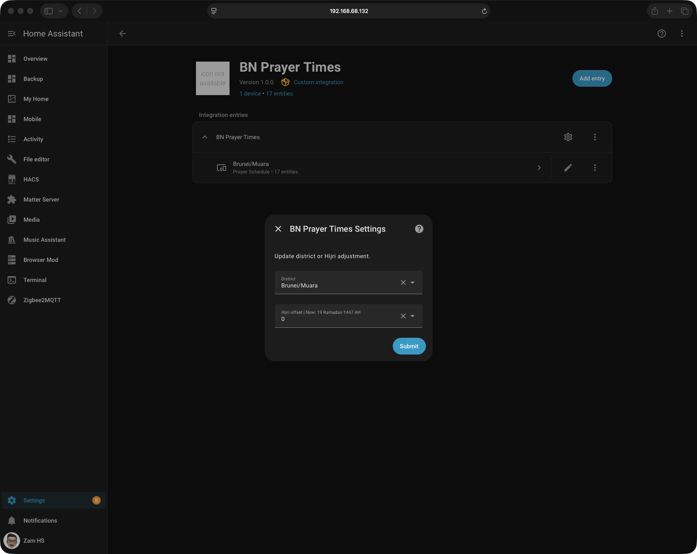
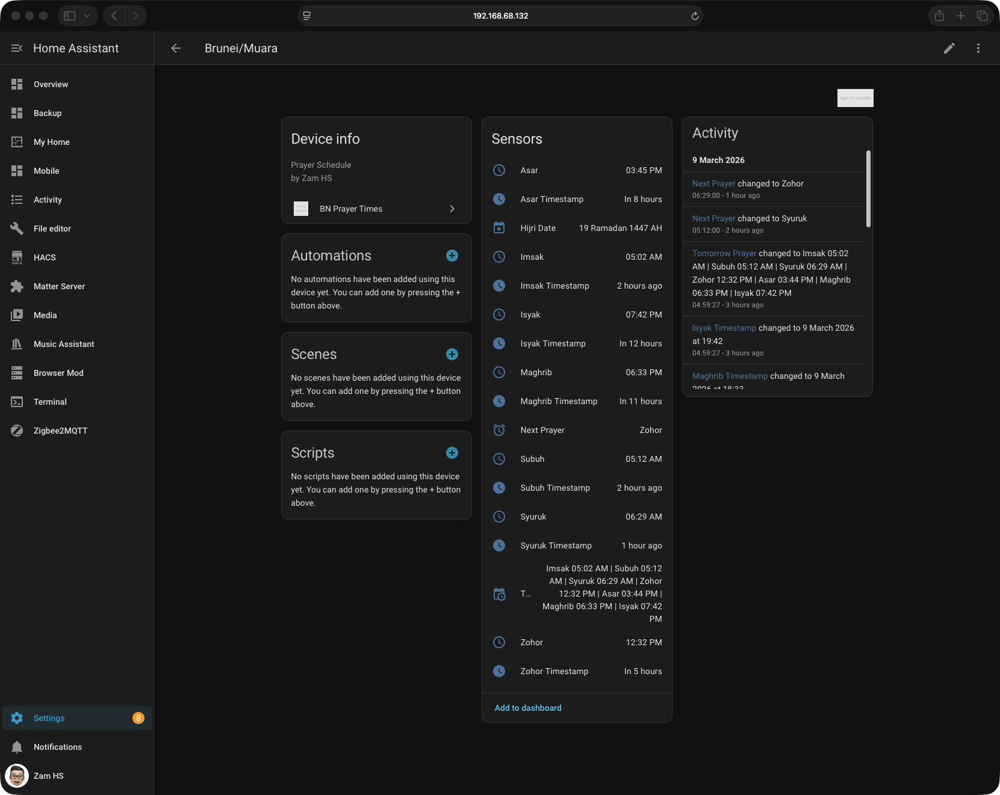
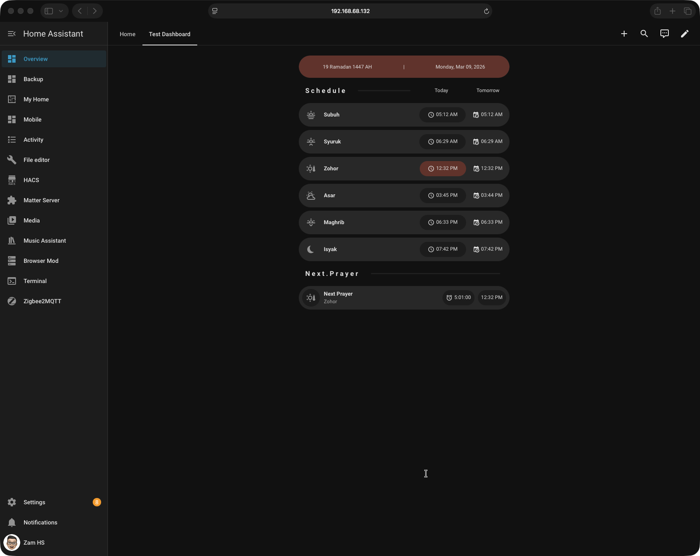

# BN Prayer Times (Brunei)

Home Assistant custom integration providing Brunei Darussalam prayer times from a local prayer schedule. This integration is designed for dashboards, and automations, featuring live countdowns, Hijri date support, and district adjustments.

## Features

- Prayer times from local prayer schedule
- Prayer timestamp for automation
- District offsets
- Hijri date (changes at Maghrib)
- Next prayer live countdown
- Tomorrow prayer schedule
- Config UI (choose district and Hijri adjustment)

## Installation (Marketplace)

1. Open Marketplace
2. Search for **BN Prayer Times** and open it
3. Click **Install**
4. Restart Home Assistant
5. Settings → Devices & Services → Add Integration → **BN Prayer Times**

### Manual (custom repository)

If it does not appear in the Marketplace search:

1. Open Marketplace
2. ⋮ → Custom repositories
3. Add `https://github.com/zam-hs/bn-prayer-times` with category **Integration**
4. Install, restart Home Assistant, then add the integration as above

## Supported Districts

- Brunei/Muara
- Tutong (+1 min)
- Kuala Belait (+3 mins)
- Temburong

## Prayer schedule coverage

The schedule is bundled in `prayers.csv` and currently covers:

| Year | Dates |
|------|-------|
| 2026 | 1 Jan 2026 – 31 Dec 2026 |

After the last covered date, the prayer, Next Prayer and Hijri sensors have no data until the integration is updated to a release that includes the next year's schedule. A warning is logged when today's date is missing.

## Automations Example

Notify before Maghrib

```yaml
description: ""
mode: single
triggers:
  - trigger: time
    at: sensor.maghrib_timestamp
    weekday:
      - mon
      - tue
      - wed
      - thu
      - fri
      - sat
      - sun
conditions: []
actions:
  - action: notify.mobile_app_zams_iphone
    metadata: {}
    data:
      message: Maghrib prayer time
```
Note: For more advanced automation, you can play the azan through a smart speaker like the Apple HomePod.

## Screenshots





## Credits

Local prayer schedule taken from:
```
Ministry of Religious Affairs, Brunei Darussalam
```
